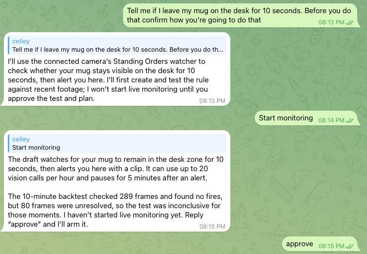
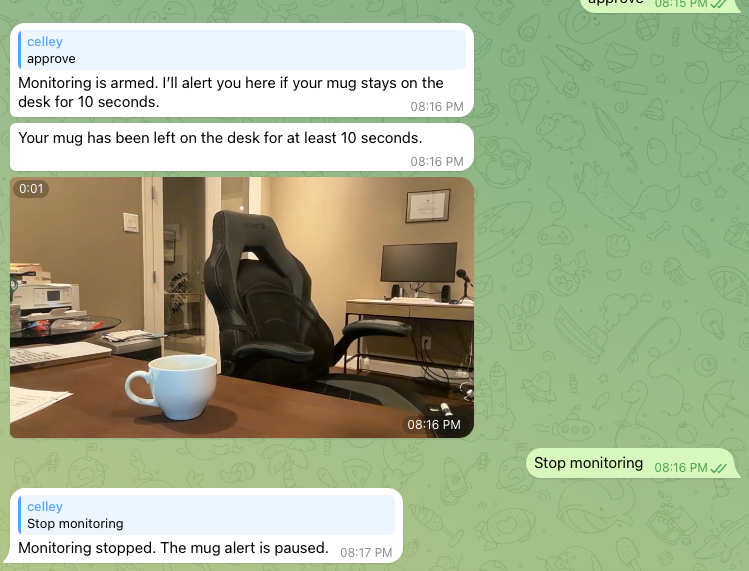

# Standing Orders

**Tell your agent what to watch for. The camera stays quiet until it happens, then your agent acts.**

A Hermes plugin that turns a webcam into a standing instruction. Say "tell me if I leave my mug on the desk for
10 seconds" and your agent wakes up on its own, with a clip as evidence, only when that becomes true.

<p>
  
  
</p>

*A real run over Telegram: ask, approve, alert with clip, stop.*

## What it's for

| You say | Your agent |
| --- | --- |
| "If I leave my mug on the desk for 10 seconds, tell me." | Messages you with the clip (tested) |
| "When a package is on the porch, text me and add 'bring in package' to my list." | Sends the clip, adds the task |
| "If the stove light is on after I leave the kitchen, remind me." | Nudges you before you're out the door |
| "When the plant looks dry, add 'water the fern' to my list." | Houseplant care, no sensor |
| "When a new sticky note appears, add what it says to my list." | Turns notes into tasks |

Agents can act but can't see what's happening around you. Standing Orders gives them eyes that open only when it
matters: no motion alerts, no zones or thresholds to set up, just a sentence. Most frames are handled locally, and
the model is called only for uncertain moments, within an hourly budget.

> **Not a safety or security system.** It can miss events and fire falsely. Don't use it where a miss could hurt
> someone. Monitor only spaces you may monitor, and follow local recording laws.

**Live test result:** 1 firing, 9 of 20 budgeted vision calls used. One take; every decision in it went through the
model rather than the local checks.

## How it works

1. You describe an order in chat: "if I leave my mug on the desk for 10 seconds after I walk away, tell me".
   `so_create_order` compiles it, with one reference frame, into a constrained JSON watch program (never code) and
   returns a plain-language plan. The order is saved unarmed. With nothing armed the camera is closed, so this takes
   one unrecorded snapshot for the compiler and discards it.
2. `so_backtest` replays recent footage through the same engine with a fake clock and lists the clips where the
   order would have fired, plus how many frames stayed unresolved. Footage exists only from times an order was
   armed, unless you turn on `record_when_idle` (below).
3. You arm it (`so_arm`). The engine samples 1 to 2 frames per second:
   - **T0** per-zone frame difference, lighting-normalized. Unchanged zones keep their last value.
   - **T1** local CLIP image embedding against the prompt, negatives and your saved examples.
   - **T2** a vision call through your own model (`ctx.llm`) only for uncertain results and a slow heartbeat,
     within an hourly budget. When the budget runs out, predicates go `unknown` and nothing fires from them.
   - **T3** deterministic time rules (`all`, `any`, `not`, `held_for`, `rose`, `fell`, `within`) with hysteresis.
   - **Confirm** three frames from the window go to T2 before any firing is delivered.
4. A firing saves the event and clip and starts a Hermes turn. The reply carries a `MEDIA:` line so the clip reaches
   your chat.
5. A wrong firing is corrected with `so_correct` or the Wrong button in the pane. The crop becomes a counter-example,
   all labeled events are replayed, and the change is kept only if the target stops firing and no correct event breaks.

## Install

```bash
hermes plugins install https://github.com/jaxsonsprinkles/standing-orders  # or link this folder into ~/.hermes/plugins/standing-orders
hermes plugins enable standing-orders
hermes orders setup                    # downloads the CLIP weights, checksum verified
hermes orders doctor --camera
```

Add to `config.yaml` so camera sessions only get the plugin's tools. Without it, a fired turn gets all of your
core tools:

```yaml
platform_toolsets:
  standing_orders: [standing_orders]
```

Set `deliver_to` in the plugin settings to the chat that should receive fired orders.

**macOS camera permission** follows the app that launched the process. A gateway started by launchd had no camera
access in testing; a gateway started with `hermes gateway run` from a Terminal that has camera access works.
If permission is missing, the platform reports itself unavailable (`so_status`, `hermes orders doctor`) instead of hanging.
A sleeping Mac stops watching; the pane says so and the plugin does not keep the machine awake.

## Commands

| Where | What |
| --- | --- |
| Chat | `/orders` shows camera state, last-hour counters and orders |
| Agent tools | `so_create_order`, `so_backtest`, `so_arm`, `so_disarm`, `so_list_orders`, `so_correct`, `so_status`, `so_add_list_item` |
| Terminal | `hermes orders setup`, `doctor [--camera]`, `benchmark [--live-vision]`, `purge` |
| Hermes Desktop | "standing orders" pane: preview, order cards, events with Right/Wrong, funnel counters |

The Desktop pane needs the plugin in `plugins.enabled` (its backend is `dashboard/plugin_api.py`) and the desktop
half enabled under Capabilities > Plugins.

## Disclosures

- **Camera use and background capture.** The camera is open and recorded only while at least one order is armed
  and the gateway runs (1 to 2 frames per second, in a thread in the gateway). It closes, and the rolling recording
  is deleted, when the last order is disarmed. One lock file guarantees one camera owner. Creating an order with
  nothing armed opens the camera once for a single frame that is used for the compile and then deleted.
  **Opt-in:** the `record_when_idle` setting (default off) records continuously whenever the gateway runs, so
  you can backtest before arming.
- **Recording.** A rolling recording of the armed periods is kept locally in `~/.hermes/plugin-data/standing-orders/`
  (60 minutes and 2 GB by default), along with event clips, orders, events and counters. Event clips in `clips/` are
  kept until `hermes orders purge`, which deletes all of it. Nothing is uploaded or stored in the cloud.
- **What goes to the model.** Only T2 and Confirm send image crops (zone crops, and 3 frames for Confirm) and the
  order's predicate prompts to the model you configured for Hermes, through `ctx.llm`. The compiler sends your
  sentence and one reference frame. The pane counts every call. The plugin reads no credentials.
- **Downloaded weights.** `hermes orders setup` downloads CLIP ONNX weights (Xenova/clip-vit-base-patch32, MIT) from
  Hugging Face at a pinned revision and verifies pinned SHA-256 checksums. Weights only, never code. No binaries are
  committed.
- **Camera content is untrusted input.** Text seen by the camera is passed to the agent as quoted data. Each order's
  action instruction is built from your sentence when the order is created; the camera cannot widen it. Hermes
  approvals still apply. Benchmark scenario 9 (a sticky note telling the agent to ignore its rules) fires normally
  and adds no action.
- **Not built:** face recognition or identifying people, cloud footage storage, automatic physical-world actions,
  Windows or Linux support.

## Benchmark

`hermes orders benchmark` (or `python benchmark/run.py`) replays 10 labeled clips of a desk through the real engine
with no camera and no model. T2 answers recorded from a real model are committed in `benchmark/cache/` so reruns
are free and repeatable; `--live-vision` re-checks against your own model.

Measured result: precision 1.0, recall 1.0, 10/10 scenarios correct. 59 vision calls over 821 s of video versus 407
for polling every 2 s. On the quiet scene, 1 call in 600 s versus 299. The engine ran at 110 to 140 frames per CPU
second including CLIP on Apple Silicon.

Caveats, in full in [docs/benchmark-results.md](docs/benchmark-results.md): one take per scenario and the settings
were looked at on the same clips (in-sample, not held-out); the quiet clip is 16 s of footage looped to 10 minutes;
the bowl never fooled the system, so correction replay is tested only on synthetic clips; event-to-delivery latency
and live CPU were not measured.

## Layout

`standing_orders/engine` has no Hermes imports and runs in plain pytest. `standing_orders/hermes` is the adapter,
tools, `/orders` and CLI. `dashboard/plugin_api.py` and `desktop/plugin.js` are the pane. Run tests with
`pytest` (needs `opencv-python-headless`, `numpy`, `onnxruntime`, `tokenizers`, `pyyaml`, `fastapi`, `httpx`).

## License

MIT
